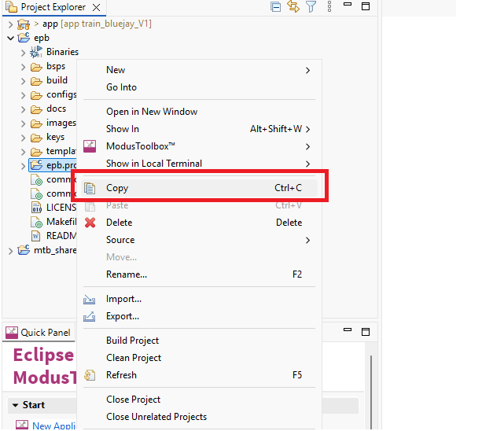
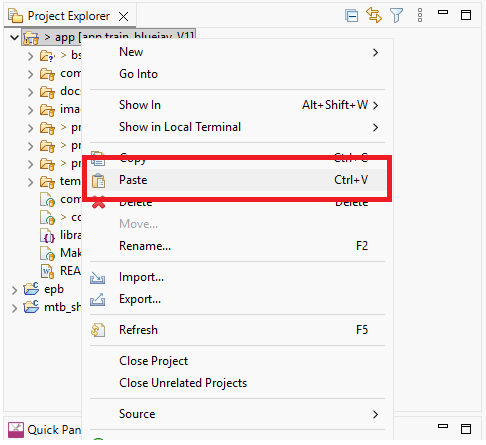
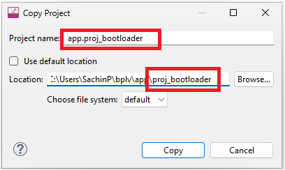

# PSOC&trade; Edge MCU: Battery-powered local voice

This code example showcases Infineon’s low power audio pipeline on the PSOC&trade; Edge MCU suitable for battery powered applications. The audio pipeline spans Arm&reg; Cortex&reg;-M33 and Arm&reg; Cortex&reg;-M55 cores.

The audio pipeline starts from CM33 core referred as Low Power "LP" core. Analog mic captures audio data, then LP core proceeds with Acoustic Activity Detection (AAD) followed by Speech-Onset-Detection (SOD), and Low Power Wake Word Detection (LPWWD). On the CM55 core referred as High Performance "HP" core, audio is processed with DEEPCRAFT&trade; Audio Enhancement (AE), Wakeword reverification/command detection is performed with DEEPCRAFT&trade; Voice Assistant (VA).

While Acoustic Activity Detection (AAD), Speech-Onset-Detection (SOD), or Low Power Wake Word Detection (LPWWD) are active, PD1 remains OFF to ensure minimal power consumption.

On detecting Low Power Wake Word (LPWW), the system goes through the PD1 power cycle enabling PD1 power domain, CM55 core, System RAM (SoCMEM) and reapplies security configurations to required subsystems in PD1 power domain.

The audio and control communication between Arm&reg; Cortex&reg;-M33 and Arm&reg; Cortex&reg;-M55 cores is handled by Staged Voice Control (SVC) middleware.

**Figure 1** shows a high-level overview of the audio pipeline.

**Figure 1. Audio pipeline**


This code example has a three project structure: CM33 secure, CM33 non-secure, and CM55 projects. All three projects are flashed into external flash. Edge Protect Bootloader is used to load CM33 secure and non-secure projects into SRAM. CM33NS copies the CM55 project into SoCMEM. The CM33 secure and CM33 non-secure are executed from SRAM and CM55 is executed from the System RAM (SoCMEM) for low power operation.

> **Notes:**

- See the [Design Guide](docs/local_voice_design_guide.md) section for the detailed description of this code example, its design, various options, and [Power profile](docs/power_profile.md) for KPI details

- This example supports only the Arm&reg; Compiler and Boot SW must be in the OFF position

- The Speech-Onset-Detection (SOD) library stops working after 30 minutes

- On a 30-minute timeout, the code will stop. See the terminal output for more information and reset the board

- This code example supports only Arm&reg;, which you need to install separately. See [Software setup](#software-setup) section


## Requirements

- [ModusToolbox&trade;](https://www.infineon.com/modustoolbox) v3.6 or later (tested with v3.6)
- Board support package (BSP) minimum required version: 1.0.0
- Programming language: C
- Associated parts: All [PSOC&trade; Edge MCU](https://www.infineon.com/products/microcontroller/32-bit-psoc-arm-cortex/32-bit-psoc-edge-arm) parts


## Supported toolchains (make variable 'TOOLCHAIN')

- Arm&reg; Compiler v6.22 (`ARM`) – Default value of `TOOLCHAIN


## Supported kits (make variable 'TARGET')

- [PSOC&trade; Edge E84 Evaluation Kit](https://www.infineon.com/KIT_PSE84_EVAL) (`KIT_PSE84_EVAL_EPC2`) – Default value of `TARGET`
- [PSOC&trade; Edge E84 Evaluation Kit](https://www.infineon.com/KIT_PSE84_EVAL) (`KIT_PSE84_EVAL_EPC4`)


## Hardware setup

This example uses the board's default configuration. See the kit user guide to ensure that the board is configured correctly.

Ensure the following jumper and pin configuration on board.
- BOOT SW must be in the OFF position
- J20 and J21 must be in the tristate/not connected (NC) position


## Software setup

See the [ModusToolbox&trade; tools package installation guide](https://www.infineon.com/ModusToolboxInstallguide) for information about installing and configuring the tools package.

- Install a terminal emulator if you do not have one. Instructions in this document use [Tera Term](https://teratermproject.github.io/index-en.html)

- Install the DEEPCRAFT&trade; Audio Enhancement (AE) Tech Pack to access the Configurator tool

- Install Arm&reg; Compiler for Embedded with version 6.22

   > **Note:** Arm&reg; account and license is required for the [Arm&reg; Compiler](https://developer.arm.com/downloads/view/ACOMPE). 

	- **Arm&reg; Compiler:**<br>
	CY_COMPILER_ARM_DIR=[path to Arm compiler installation] <br>
	For example: *C:/Program Files/ArmCompilerforEmbedded6.22*


## Operation

See [Using the code example](docs/using_the_code_example.md) for instructions on creating a project, opening it in various supported IDEs, and performing tasks, such as building, programming, and debugging the application within the respective IDEs.

1. Create the Edge Protect Bootloader and PSOC&trade; Edge MCU: battery-powered local voice application 

2. Copy the **proj_bootloader** from **PSOC_Edge_Protect_Bootloader** to root of the battery-powered local voice application, where other projects (CM33, CM33 secure, and CM55) are placed

See the **Figure 2** for copying the bootloader project into battery-powered-local-voice

**Figure 2.Copy bootloader project to battery-powered-local-voice code**



See the **Figure 3** to paste the copied bootloader project into battery-powered-local-voice and **Figure 4** for changing bootloader project name <project_name>.proj_bootloader and disable the **use default location** checkbox changing the path to <project_location> and add **\proj_bootloader** to it

**Figure 3.Paste copied bootloader project to battery-powered-local-voice code**



**Figure 4.Changing project name and path**



3. Open the *Makefile* in the root of the application and add ‘proj_bootloader’ to MTB_PROJECTS variable as follows:

   ```
   MTB_PROJECTS=proj_cm33_s proj_cm33_ns proj_cm55 proj_bootloader
   ```

4. Select **PSOC&trade; Edge MCU: battery-powered local voice** in IDE and execute **make config** command from terminal and save the opened design.modus file

5. Open the *common.mk* file in the root of the application and remove **#** in front of COMBINE_SIGN_JSON or replace it with the following: 

   ```
   COMBINE_SIGN_JSON=bsps/TARGET_$(TARGET)/config/GeneratedSource/boot_with_bldr.json
   ```

6. See [How to build and flash](docs/using_the_code_example.md). After programming, the application starts automatically

   **Figure 5. Application start screen**

   

7.  After the board is boot up, say the wake word "Okay Infineon"

    On successful detection, red and green LEDs will glow. Indicating that the kit is waiting for commands. Red LED indicates Low Power Wake Word  (LPWW) is detected and green LED indicates High Performance Wake Word (HPWW) is detected

8.  After the red and green LEDs glow, speak any of the supported commands or intents as shown in **Figure 6**

    **Figure 6. Supported commands and intents**

    

    On successful command detection, observe that blue LED id turned on for 1 second and after that all the three LEDs should turn off

9.  Monitor the UART terminal for the detection status; the terminal should print the detection results

10.  See [Preliminary KPI: Power profile](./docs/power_profile.md) for power numbers of each stage of the audio pipeline

    > **Note:** When profiling the power, disable the debug logs (set the `APP_LOG_PRINT_EN` to `0U` in the *common_modules/COMPONENT_APP_LOGGER/app_logger.h* file) to match the power numbers


## Related resources

Resources  | Links
-----------|----------------------------------
Application notes  | [AN235935](https://www.infineon.com/AN235935) – Getting started with PSOC&trade; Edge E8 MCU on ModusToolbox&trade; software <br> [AN240916](https://www.infineon.com/AN240916) – DEEPCRAFT&trade; Audio Enhancement (AE) on PSOC&trade; Edge E84 MCU
Code examples  | [Using ModusToolbox&trade;](https://github.com/Infineon/Code-Examples-for-ModusToolbox-Software) on GitHub
Device documentation | [PSOC&trade; Edge MCU datasheets](https://www.infineon.com/products/microcontroller/32-bit-psoc-arm-cortex/32-bit-psoc-edge-arm#documents) <br> [PSOC&trade; Edge MCU reference manuals](https://www.infineon.com/products/microcontroller/32-bit-psoc-arm-cortex/32-bit-psoc-edge-arm#documents)
Development kits | Select your kits from the [Evaluation board finder](https://www.infineon.com/cms/en/design-support/finder-selection-tools/product-finder/evaluation-board)
Libraries  | [mtb-dsl-pse8xxgp](https://github.com/Infineon/mtb-dsl-pse8xxgp) – Device support library for PSE8XXGP <br> [retarget-io](https://github.com/Infineon/retarget-io) – Utility library to retarget STDIO messages to a UART port
Tools  | [ModusToolbox&trade;](https://www.infineon.com/modustoolbox) – ModusToolbox&trade; software is a collection of easy-to-use libraries and tools enabling rapid development with Infineon MCUs for applications ranging from wireless and cloud-connected systems, edge AI/ML, embedded sense and control, to wired USB connectivity using PSOC&trade; Industrial/IoT MCUs, AIROC&trade; Wi-Fi and Bluetooth&reg; connectivity devices, XMC&trade; Industrial MCUs, and EZ-USB&trade;/EZ-PD&trade; wired connectivity controllers. ModusToolbox&trade; incorporates a comprehensive set of BSPs, HAL, libraries, configuration tools, and provides support for industry-standard IDEs to fast-track your embedded application development

<br>


## Other resources

Infineon provides a wealth of data at [www.infineon.com](https://www.infineon.com) to help you select the right device, and quickly and effectively integrate it into your design.


## Document history

Document title: *CE242354* – *PSOC&trade; Edge MCU: Battery-powered local voice*

 Version | Description of change
 ------- | ---------------------
 1.0.0   | New code example
<br>


All referenced product or service names and trademarks are the property of their respective owners.

The Bluetooth&reg; word mark and logos are registered trademarks owned by Bluetooth SIG, Inc., and any use of such marks by Infineon is under license.

PSOC&trade;, formerly known as PSoC&trade;, is a trademark of Infineon Technologies. Any references to PSoC&trade; in this document or others shall be deemed to refer to PSOC&trade;.

---------------------------------------------------------

(c) 2025, Infineon Technologies AG, or an affiliate of Infineon Technologies AG. All rights reserved.
This software, associated documentation and materials ("Software") is owned by Infineon Technologies AG or one of its affiliates ("Infineon") and is protected by and subject to worldwide patent protection, worldwide copyright laws, and international treaty provisions. Therefore, you may use this Software only as provided in the license agreement accompanying the software package from which you obtained this Software. If no license agreement applies, then any use, reproduction, modification, translation, or compilation of this Software is prohibited without the express written permission of Infineon.
<br>
Disclaimer: UNLESS OTHERWISE EXPRESSLY AGREED WITH INFINEON, THIS SOFTWARE IS PROVIDED AS-IS, WITH NO WARRANTY OF ANY KIND, EXPRESS OR IMPLIED, INCLUDING, BUT NOT LIMITED TO, ALL WARRANTIES OF NON-INFRINGEMENT OF THIRD-PARTY RIGHTS AND IMPLIED WARRANTIES SUCH AS WARRANTIES OF FITNESS FOR A SPECIFIC USE/PURPOSE OR MERCHANTABILITY. Infineon reserves the right to make changes to the Software without notice. You are responsible for properly designing, programming, and testing the functionality and safety of your intended application of the Software, as well as complying with any legal requirements related to its use. Infineon does not guarantee that the Software will be free from intrusion, data theft or loss, or other breaches (“Security Breaches”), and Infineon shall have no liability arising out of any Security Breaches. Unless otherwise explicitly approved by Infineon, the Software may not be used in any application where a failure of the Product or any consequences of the use thereof can reasonably be expected to result in personal injury.
