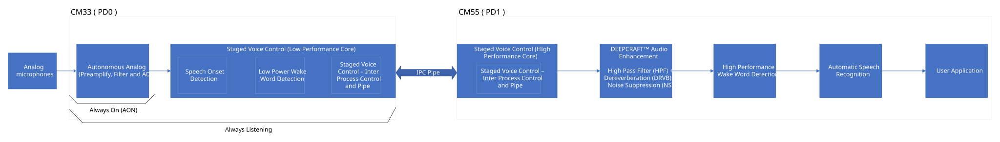
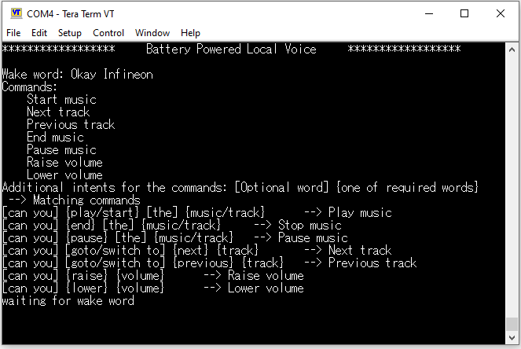
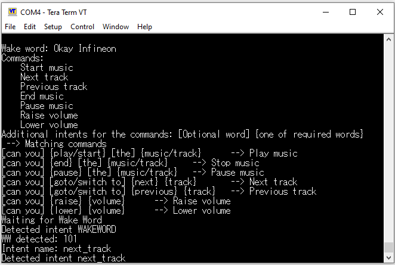
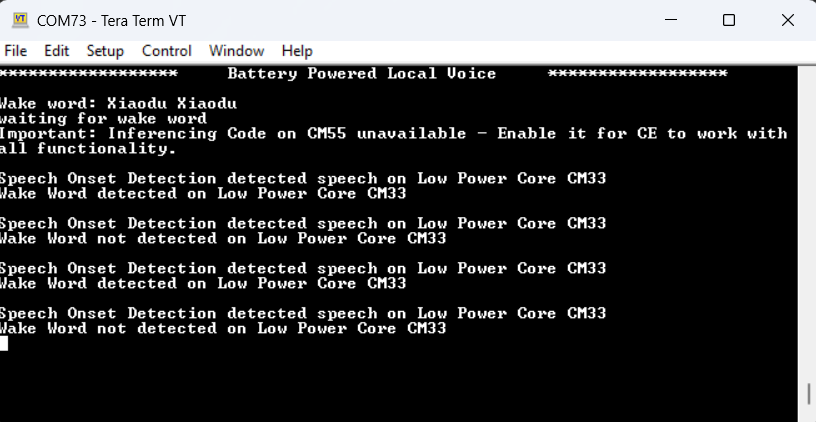

# PSOC&trade; Edge MCU: Battery-powered local voice

This code example showcases Infineon’s low power audio pipeline on the PSOC&trade; Edge MCU for battery powered applications. It is a reference design that can be customized for a broad range of low-power audio use cases and is not tied to a fixed application scenario. The audio pipeline spans Arm&reg; Cortex&reg;-M33 and Arm&reg; Cortex&reg;-M55 cores.

The audio pipeline starts from CM33 core referred to as low power (LP) core. Analog mic captures audio data, then LP core proceeds with Acoustic Activity Detection (AAD) followed by Speech-Onset-Detection (SOD), and Low Power Wake Word Detection (LPWWD). On the CM55 core referred to as high performance (HP) core, audio is processed with DEEPCRAFT&trade; Audio Enhancement (AE), wake word reverification and command detection is performed using DEEPCRAFT&trade; Voice Assistant (VA).

While Acoustic Activity Detection (AAD), Speech-Onset-Detection (SOD), or Low Power Wake Word Detection (LPWWD) are active, PD1 remains OFF to ensure minimal power consumption.

On detecting Low Power Wake Word (LPWW), the system goes through the PD1 power cycle, enabling the PD1 power domain, the CM55 core, system RAM (SoCMEM), and reapplies the security configurations to the required subsystems within PD1 power domain.

Audio and control communication between the Arm&reg; Cortex&reg;-M33 and Arm&reg; Cortex&reg;-M55 cores is handled by the Staged Voice Control (SVC) middleware.

**Figure 1** shows a high-level overview of the audio pipeline.

**Figure 1. Audio pipeline**



This code example has a three project structure: CM33 secure, CM33 non-secure, and CM55 projects. All three projects are flashed into external flash. Edge Protect Bootloader is used to load CM33 secure and non-secure projects into SRAM. CM33NS copies the CM55 project into SoCMEM. The CM33 secure and CM33 non-secure are executed from SRAM and CM55 is executed from the system RAM (SoCMEM) for low power operation.

> **Notes:**
> - See the [Design Guide](docs/local_voice_design_guide.md) section for the detailed description of this code example, its design, various options, and [Power profile](docs/power_profile.md) for KPI details
> - This example supports the Arm&reg; and LLVM Compiler and Boot SW must be in the OFF position
> - The Speech-Onset-Detection (SOD) library stops working after 30 minutes. For the unlimited license, contact Infineon support. See [Using the code example](docs/using_the_code_example.md) or *note.md* in *proj_cm55\source\modules\audio_voice_core_lib* for placing the licensed version of libraries within the code folder structure
> - On a 30-minute timeout, the code will stop. See the terminal output for more information and reset the board
> - This code example supports Arm&reg; and LLVM compilers, which you need to install separately. See [Software setup](#software-setup) section


## Requirements

- [ModusToolbox&trade;](https://www.infineon.com/modustoolbox) v3.8 or later (tested with v3.8)
- Board support package (BSP) minimum required version: 1.0.0
- Programming language: C
- Associated parts: All [PSOC&trade; Edge MCU](https://www.infineon.com/products/microcontroller/32-bit-psoc-arm-cortex/32-bit-psoc-edge-arm) parts


## Supported toolchains (make variable 'TOOLCHAIN')

- Arm&reg; Compiler v6.22 (`ARM`) – Default value of `TOOLCHAIN`
- LLVM Embedded Toolchain for Arm&reg; v19.1.5 (`LLVM_ARM`)


## Supported kits (make variable 'TARGET')

- [PSOC&trade; Edge E84 Evaluation Kit](https://www.infineon.com/KIT_PSE84_EVAL) (`KIT_PSE84_EVAL_EPC2`) – Default value of `TARGET`
- [PSOC&trade; Edge E84 Evaluation Kit](https://www.infineon.com/KIT_PSE84_EVAL) (`KIT_PSE84_EVAL_EPC4`)


## Hardware setup

This example uses the board's default configuration. See the kit user guide to ensure that the board is configured correctly.

Ensure the following jumper and pin configuration on board.
- BOOT SW must be in the OFF position
- J20 and J21 must be in the tristate/not connected (NC) position


## Software setup

See the [ModusToolbox&trade; tools package installation guide](https://www.infineon.com/ModusToolboxInstallguide) for information about installing and configuring the tools package.

- Install a terminal emulator if you do not have one. Instructions in this document use [Tera Term](https://teratermproject.github.io/index-en.html)

- Install the DEEPCRAFT&trade; Audio Enhancement (AE) Tech Pack to access the Configurator tool

- Install Arm&reg; Compiler for Embedded with version 6.22

   > **Note:** Arm&reg; account and license is required for the [Arm&reg; Compiler](https://developer.arm.com/downloads/view/ACOMPE)

	Alternatively, install the [LLVM](https://github.com/ARM-software/LLVM-embedded-toolchain-for-Arm/releases/tag/release-19.1.5) compiler, which does not require a license

	Depending on your choice of compiler (Arm&reg;, LLVM), set these environmental variables on the PC settings or uncomment in *common.mk* and set the path:

	1.	**Arm&reg; Compiler:**<br>
	CY_COMPILER_ARM_DIR=[path to Arm compiler installation] <br>
	For example: *C:/Program Files/ArmCompilerforEmbedded6.22*

	2. **LLVM Compiler:** <br>
	CY_COMPILER_LLVM_ARM_DIR=[path to LLVM compiler location] <br>
	For example: *C:/llvm/LLVM-ET-Arm-19.1.5-Windows-x86_64*


## Wake word model selection

This code example supports two modes of operation:

- `CONFIG_INFERENCING_MODE=HP_INFERENCING` for the full pipeline, where CM55 is used for high-performance wake-word reverification and command detection
- `CONFIG_INFERENCING_MODE=LPWWD_ONLY` for Low Power Wake Word Detection only

You can set the inferencing mode in `common.mk`.

You can select the wake word model based on the mode selected:

- Full pipeline mode supports only Okay Infineon (`SVC_OK_INFINEON`)
- LPWWD only mode supports Okay Infineon (`SVC_OK_INFINEON`), Alexa (`SVC_ALEXA`), Hey Google (`SVC_HEY_GOOGLE`), and Xiaodu Xiaodu (`SVC_XIAODU_XIAODU`)

To switch the wake word model, edit `proj_cm33_ns/Makefile` and update the wake-word component selection as follows:

```
# Enable a specific wake word model by adding one of the following
#  COMPONENTS+=SVC_OK_INFINEON
#  COMPONENTS+=SVC_ALEXA
#  COMPONENTS+=SVC_HEY_GOOGLE
#  COMPONENTS+=SVC_XIAODU_XIAODU
```

Keep only one `COMPONENTS+=SVC_...` line enabled at a time.


## Operation

See [Using the code example](docs/using_the_code_example.md) for instructions on creating a project, opening it in various supported IDEs, and performing tasks, such as building, programming, and debugging the application within the respective IDEs.

1. See [How to build and flash](docs/using_the_code_example.md). After programming, the application starts automatically

   **Figure 2. Application start screen**

   

2.  After the board boots up, say the wake word "Okay Infineon"

    Upon successful detection, the red and green LEDs illuminate, indicating that the kit is ready to receive commands. The red LED indicates that the Low Power Wake Word  (LPWW) has been detected and the green LED indicates that the High Performance Wake Word (HPWW) has been detected

3.  After the red and green LEDs glow, speak any of the supported commands or intents, as shown in **Figure 3**

    **Figure 3. Supported commands and intents**

    

    Upon successful command detection, observe that the blue LED is turned on for 1 second. Afterward, all three LEDs turn off

4.  Monitor the UART terminal for the detection status; the terminal should print the detection results

    When operating in `CONFIG_INFERENCING_MODE=LPWWD_ONLY`, the expected audio pipeline flow is:

    `AAD -> SOD -> LPWWD`

    In this mode, only the low-power stages on CM33 are active and CM55 is not powered up. The UART output will show acoustic activity, speech onset, and wake word detection events only, with no HPWWD reverification or command detection logs

    **Figure 4. UART terminal output – LPWWD only mode**

    

5. For Push-To-Talk (PTT), press and hold user BTN1 (SW2) for approximately 300 ms, then immediately speak the command

6. To enter or exit the application streaming state, press User BTN2 (available only in `CONFIG_INFERENCING_MODE=HP_INFERENCING`):

   - **Enter streaming mode**: Press BTN2 once. The system bypasses Speech Onset Detection (SOD) and Low Power Wake Word Detection (LPWWD) and immediately hands audio control to CM55 for continuous High Performance Wake Word (HPWWD) and ASR inferencing. The red LED is always ON in the streaming state. PTT (BTN1) is still available to manually trigger ASR. When USB streaming is configured for CM55 via CONFIG_USB_STREAMING variable in common.mk, switch to the streaming state first by pressing BTN2 and then capture the four-channel USB audio

   - **Exit streaming mode**: Press BTN2 again. The system aborts streaming, restores LP Wake Word Detection, and switches the ADC back to the low-power configuration. All LEDs are turned OFF

7. Review the [Design Guide](docs/local_voice_design_guide.md) to understand the system design, configuration options, and implementation details

8.  See [Preliminary KPI: Power profile](./docs/power_profile.md) for power numbers of each stage of the audio pipeline

    > **Note:** When profiling the power, disable the debug logs (set the `APP_LOG_PRINT_EN` to `0U` in the *common_modules/COMPONENT_APP_LOGGER/app_logger.h* file) to match the power numbers


## Related resources

Resources  | Links
-----------|----------------------------------
Application notes  | [AN235935](https://www.infineon.com/AN235935) – Getting started with PSOC&trade; Edge E8 MCU on ModusToolbox&trade; software <br> [AN240916](https://www.infineon.com/AN240916) – DEEPCRAFT&trade; Audio Enhancement (AE) on PSOC&trade; Edge E84 MCU
Code examples  | [Using ModusToolbox&trade;](https://github.com/Infineon/Code-Examples-for-ModusToolbox-Software) on GitHub
Device documentation | [PSOC&trade; Edge MCU datasheets](https://www.infineon.com/products/microcontroller/32-bit-psoc-arm-cortex/32-bit-psoc-edge-arm#documents) <br> [PSOC&trade; Edge MCU reference manuals](https://www.infineon.com/products/microcontroller/32-bit-psoc-arm-cortex/32-bit-psoc-edge-arm#documents)
Development kits | Select your kits from the [Evaluation board finder](https://www.infineon.com/cms/en/design-support/finder-selection-tools/product-finder/evaluation-board)
Libraries  | [mtb-dsl-pse8xxgp](https://github.com/Infineon/mtb-dsl-pse8xxgp) – Device support library for PSE8XXGP <br> [retarget-io](https://github.com/Infineon/retarget-io) – Utility library to retarget STDIO messages to a UART port
Tools  | [ModusToolbox&trade;](https://www.infineon.com/modustoolbox) – ModusToolbox&trade; software is a collection of easy-to-use libraries and tools enabling rapid development with Infineon MCUs for applications ranging from wireless and cloud-connected systems, edge AI/ML, embedded sense and control, to wired USB connectivity using PSOC&trade; Industrial/IoT MCUs, AIROC&trade; Wi-Fi and Bluetooth&reg; connectivity devices, XMC&trade; Industrial MCUs, and EZ-USB&trade;/EZ-PD&trade; wired connectivity controllers. ModusToolbox&trade; incorporates a comprehensive set of BSPs, HAL, libraries, configuration tools, and provides support for industry-standard IDEs to fast-track your embedded application development

<br>


## Other resources

Infineon provides a wealth of data at [www.infineon.com](https://www.infineon.com) to help you select the right device, and quickly and effectively integrate it into your design.


## Document history

Document title: *CE242354* – *PSOC&trade; Edge MCU: Battery-powered local voice*

 Version | Description of change
 ------- | ---------------------
 1.0.0   | New code example
 1.1.0   | Added MTB_SUPPORTED_TOOLCHAINS variable for automated build systems <br> Updated design files to fix ModusToolbox&trade; v3.7 build warnings
 1.2.0   | Added PTT feature <br> Added support for other wake word models in LPWWD only mode <br> Enabled MCPS profiling feature <br> Added LLVM_ARM compiler support
 1.3.0   | Added USB streaming feature <br> Added Bring your own LPWWD feature and other minor updates
 1.3.1   | Fix COMBINE_SIGN_JSON shareability for fresh clone <br> Updated the linker script to support LLVM ATfE v22.1.0
<br>


All referenced product or service names and trademarks are the property of their respective owners.

The Bluetooth&reg; word mark and logos are registered trademarks owned by Bluetooth SIG, Inc., and any use of such marks by Infineon is under license.

PSOC&trade;, formerly known as PSoC&trade;, is a trademark of Infineon Technologies. Any references to PSoC&trade; in this document or others shall be deemed to refer to PSOC&trade;.

---------------------------------------------------------

(c) 2026, Infineon Technologies AG, or an affiliate of Infineon Technologies AG. All rights reserved.
This software, associated documentation and materials ("Software") is owned by Infineon Technologies AG or one of its affiliates ("Infineon") and is protected by and subject to worldwide patent protection, worldwide copyright laws, and international treaty provisions. Therefore, you may use this Software only as provided in the license agreement accompanying the software package from which you obtained this Software. If no license agreement applies, then any use, reproduction, modification, translation, or compilation of this Software is prohibited without the express written permission of Infineon.
<br>
Disclaimer: UNLESS OTHERWISE EXPRESSLY AGREED WITH INFINEON, THIS SOFTWARE IS PROVIDED AS-IS, WITH NO WARRANTY OF ANY KIND, EXPRESS OR IMPLIED, INCLUDING, BUT NOT LIMITED TO, ALL WARRANTIES OF NON-INFRINGEMENT OF THIRD-PARTY RIGHTS AND IMPLIED WARRANTIES SUCH AS WARRANTIES OF FITNESS FOR A SPECIFIC USE/PURPOSE OR MERCHANTABILITY. Infineon reserves the right to make changes to the Software without notice. You are responsible for properly designing, programming, and testing the functionality and safety of your intended application of the Software, as well as complying with any legal requirements related to its use. Infineon does not guarantee that the Software will be free from intrusion, data theft or loss, or other breaches (“Security Breaches”), and Infineon shall have no liability arising out of any Security Breaches. Unless otherwise explicitly approved by Infineon, the Software may not be used in any application where a failure of the Product or any consequences of the use thereof can reasonably be expected to result in personal injury.
