[Click here](../README.md) to view the README.

## Design and implementation

The design of this application is minimalistic to get started with code examples on PSOC&trade; Edge MCU devices. All PSOC&trade; Edge E84 MCU applications have a dual-CPU three-project structure to develop code for the CM33 and CM55 cores. The CM33 core has two separate projects for the secure processing environment (SPE) and non-secure processing environment (NSPE). A project folder consists of various subfolders, each denoting a specific aspect of the project. The three project folders are as follows:

**Table 1. Application projects**

Project | Description
--------|------------------------
*proj_cm33_s* | Project for CM33 secure processing environment (SPE)
*proj_cm33_ns* | Project for CM33 non-secure processing environment (NSPE)
*proj_cm55* | CM55 project

In this code example, the Edge Protect bootloader is used to load the CM33 secure and non-secure projects to SRAM. On power on, Extended Boot launches the Edge Protect Bootloader. Both CM33 projects, namely proj_cm33_s, proj_cm33_ns are configured to be stored in external flash memory and loaded to SRAM by the Edge Protect Bootloader. CM55 project is also stored in external flash but loaded into System RAM (SoCMEM) by CM33 non-secure whenever Low Power Wake Word (LPWW) is detected.

**Battery-powered local voice with analog microphone:**

In the CM33 non-secure application running on Arm&reg; Cortex&reg;-M33 core, the clocks and system resources are initialized by the BSP initialization function. The retarget-io middleware is configured to use the debug UART and the user LEDs are initialized. Battery-powered application on Low Power (LP) core initializes the Staged Voice Control (SVC) Low Power (LP) component of Staged Voice Control (SVC) middleware and analog microphone.

In the CM55 application running on Arm&reg; Cortex&reg;-M55 core, the clocks and system resources are initialized by the BSP initialization function. The retarget-io middleware is configured to use the debug UART. Battery-powered application on CM55 initializes Staged Voice Control (SVC) High Performance (HP) component of Staged Voice Control (SVC) middleware, DEEPCRAFT&trade; Audio Enhancement (AE) and DEEPCRAFT&trade; Voice Assistant (VA) libraries.

To understand the Staged Voice Control (SVC) state machine in detail, refer to the [SVC README](https://github.com/Infineon/staged-voice-control/blob/master/README.md).

**SVC state machine**


In CM33 non-secure application, Acoustic Activity Detection (AAD) is the lowest power stage and the device will be in Acoustic Activity Detection (AAD) stage. Acoustic Activity Detection (AAD) is followed by Speech Onset Detection (SOD), which detects the presence of human speech in the Analog mic data and then triggers Low Power Wake Word Detection (LPWWD).

Once Low Power Wake Word (LPWW) is detected, it is sent to the CM55 application for reverification via Staged Voice Control (SVC). Once the wake word is reverified, then the spoken commands are streamed to the CM55 application for ASR commands (intent) detection. All the audio data pass through the DEEPCRAFT&trade; Audio Enhancement (AE) for audio processing.

For the detailed explanation of design flow, see **Figure 1**.

**Figure 1. Battery-powered local voice design flow**

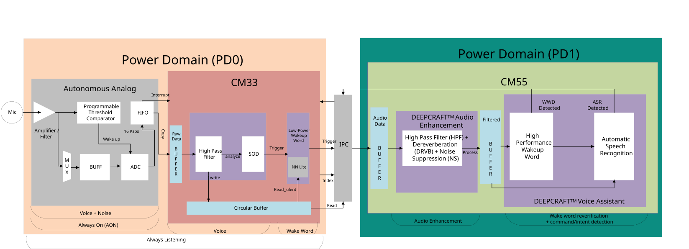

This code example uses a single analog microphone as shown in **Figure 1**. High Pass Filter (HPF), Dereverberation (DRVB) and Noise Suppression (NS) components are enabled within DEEPCRAFT&trade; Audio Enhancement (AE).

Other AFE components such as Beam Forming (BF), Acoustic Echo Cancellation (AEC), Echo Suppression (ES) are not enabled. Since analog mic has mono output, Beam Forming (BF) is disabled. Acoustic Echo Cancellation (AEC)/Echo Suppression (ES) are disabled as there is no audio playback demonstrated in this code example.

If you need Acoustic Echo Cancellation (AEC), refer to the [PSOC&trade; Edge MCU: Mains-powered local voice Code Example](https://github.com/Infineon/mtb-example-psoc-edge-mains-powered-local-voice).

See this file for all the commands depending on the voice assistant project loaded to the code example:
*proj_cm55\source\battery_powered_application_hp\inferencing_interface\COMPONENT_VOICE_ASSISTANT\va_model\command_list_[project_name].txt*.


## Logging Configuration For Low Power

- **Enabling the logs**

   To enable the logs, set the **APP_LOG_PRINT_EN** to **1U** in the **common_modules/COMPONENT_APP_LOGGER/app_logger.h** file. For debug purpose, logs of CM33 can be enabled by setting the **ENABLE_CM33_LOGS** to **1U** in the **proj_cm33_ns/main.c** file

- **Disabling the logs**

   To disable the logs, set the **APP_LOG_PRINT_EN** to **0U** in the **common_modules/COMPONENT_APP_LOGGER/app_logger.h** file.


## Code structure

The code is structured into dedicated folders for every configuration. **Figure 2** shows the high-level folder organization of the code example.

**Figure 2. Project folder structure**

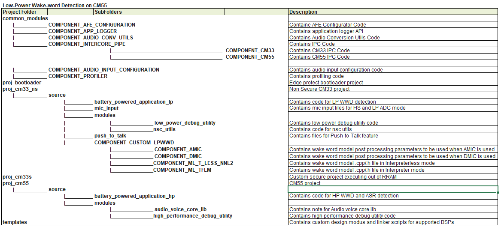


## Code flow

**Figure 3** shows the code flow for battery-powered configuration for Ok Infineon wake word and play music command.

**Figure 3. Code flow**

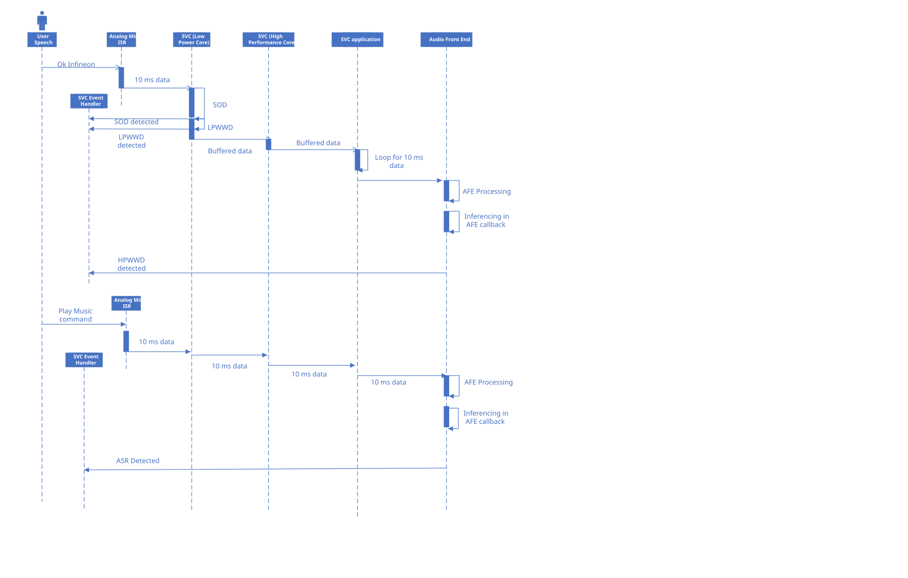


## Audio pipeline customizations (how to's/recommendations)

The audio pipeline can be customized. The following details about the customizations.

**USB streaming options**

USB streaming lets you feed audio into the pipeline from a host, or capture mic audio on the host for tuning. It is controlled by the **CONFIG_USB_STREAMING** macro in the **common.mk** file. Three options are supported:

**Table 2. Input options**

USB streaming option | Description
---------------------|------------------------
*CM33* | Enable USB streaming input on CM33, the audio from USB host (PC) is provided as input to the kit. For example, test streams that have wake word and command utterances. This option sets the `USB_FEED_TO_SVC` define. <br> **Note** - When streaming audio over USB, make sure to also stream periods of silence along with wake word/voice commands so that detections work correctly. In this mode, there is no analog mic input to the audio pipeline. This means the audio pipeline states change only if there is continuous audio data via USB, including silence data
*CM55* | Enable USB streaming on CM55, the audio from the kit is streamed back to the USB host (PC) via USB. Sets the `CY_AFE_ENABLE_TUNING_FEATURE` define for DEEPCRAFT&trade; Audio Enhancement (AE) tuning. For more details see DEEPCRAFT&trade; Audio Enhancement (AE) configuration section. To use this feature, first put the system in streaming mode with BTN2 press and then capture the 4 channel USB audio from the kit
*NONE* | USB streaming is disabled. This is the default for the low-power battery-powered demonstration

The default value of this parameter is 'NONE' in **common.mk** and mono audio from Analog mic is used.

```
CONFIG_USB_STREAMING=NONE
```


**Acoustic Activity Detection (AAD) configuration**

The settings can be adjusted in the *proj_cm33_ns/source/battery_powered_application_lp/audio_feed_to_svc.h* file.

- Acoustic Activity Detection timeout is configured to detect silence for 7000 ms <br>
- Acoustic Activity Detection threshold is set to 7000 counts to detect silence <br>
- Acoustic Activity Detection feature is set to true to enable the feature <br>

    ```
    aad_config.timeout_ms = SOD_TO_AAD_TIMEOUT_MS;
    aad_config.low_noise_threshold = SOD_TO_AAD_THRESHOLD;
    aad_config.enable_feature = true;
    ```
<br>

**Speech Onset Detection (SOD) configuration**

The settings can be adjusted in the *proj_cm33_ns/source/battery_powered_application_lp/audio_feed_to_svc.c* file.

- Speech Onset Detection is configured for an onset gap of 500 ms <br>
- The sensitivity of SOD ranges from 0 = least sensitive to 32767 (MAX_SOD_SENSITIVITY) = most sensitive <br>
- In the code 16384 = nominal sensitive is used

    ```
    init_svc.sod_onset_detect_max_late_hit_delay_ms = SOD_HIT_DELAY;
    init_svc.sod_onset_gap_setting_ms = CY_SOD_ONSET_GAP_SETTING_500_MS;
    init_svc.sod_sensitivity = SOD_SENSITIVITY;
    ```
- Gain control can be adjusted by modifying the `gain_control.post_hpf_gain` and `gain_control.sod_processing_gain` in *proj_cm33_ns/source/battery_powered_application_lp/audio_feed_to_svc.c* file. By default, these are set to 1 for Near field detection. For Far field detection, set it to 3

    ```
    cy_svc_lp_gain_config_t gain_control;
    gain_control.post_hpf_gain = POST_HPF_GAIN; // 1 - Near field, 3 - Far field
    gain_control.sod_processing_gain = SOD_PROCESSING_GAIN; //1 - Near field, 3 - Far field
    ```
<br>

**Staged voice control (SVC) customization**

To detect Low Power Wake Word only, set the **CONFIG_INFERENCING_MODE** macro to **LPWWD_ONLY** in the **common.mk** file.
1. Enable CM33 prints by setting **ENABLE_CM33_LOGS** macro to **1U** in **proj_cm33_ns/main.c** file
2. Red LED will be toggled for every Low Power Wake Word Detection (LPWWD) detected

**Figure 4. LPWWD only state machine**

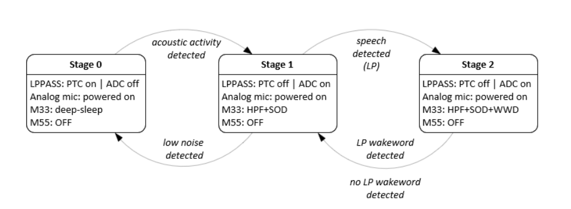

To detect High Performance Wake Word and Command (enable CM55), set the **CONFIG_INFERENCING_MODE** macro to **HP_INFERENCING** in the **common.mk** file.

**DEEPCRAFT&trade; Audio Enhancement (AE) configuration**

The DEEPCRAFT&trade; Audio Enhancement (AE) modules are chosen via the DEEPCRAFT&trade; Audio Enhancement (AE) Configurator tool. Use the DEEPCRAFT&trade; Audio Enhancement (AE) Configurator project file present at path *common_modules\COMPONENT_AFE_CONFIGURATION\battery_powered_ae_config.mtbafe*.

See **Figure 5** to check if number of channels is set to 1.

**Figure 5. Number of channels**

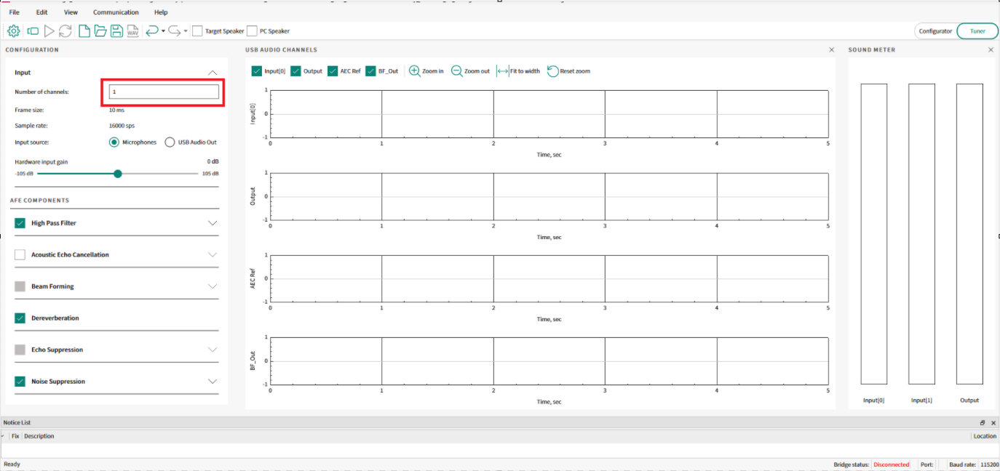

Users can monitor the four-channel USB from kit to PC for DEEPCRAFT&trade; Audio Enhancement (AE) Tuning, however simultaneous USB feed and tuning is not supported in this code example.

> **Notes:**
> - Choose the modules from High Pass Filter (HPF), Dereverberation (DRVB) and Noise Suppression (NS) to enable or disable as shown in **Figure 6** because this code example supports only High Pass Filter (HPF), Dereverberation (DRVB) and Noise Suppression (NS)<br>
> - High Pass Filter (HPF), Dereverberation (DRVB) and Noise Suppression (NS) components are enabled in DEEPCRAFT&trade; Audio Enhancement (AE) by default. <br>

**Figure 6. AFE configuration**

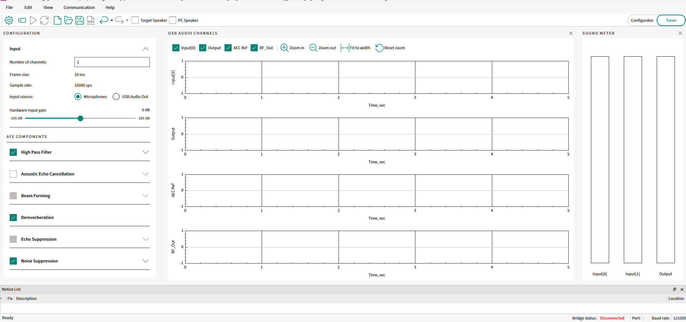

- Save the DEEPCRAFT&trade; Audio Enhancement (AE) configuration

- Build and flash the code <br>

> **Notes:**
> - Refer to [Audio Enhancement (AN240916)](https://www.infineon.com/AN240916) – DEEPCRAFT&trade; Audio Enhancement (AE) for understanding about the Audio Enhancement (AE) and tuning.
> - For DEEPCRAFT&trade; Audio Enhancement (AE) and DEEPCRAFT&trade; Voice Assistant (VA) performance KPI, please refer to the [mains-powered-local-voice design guide](https://github.com/Infineon/mtb-example-psoc-edge-mains-powered-local-voice/blob/master/docs/local_voice_design_guide.md)

<br>

**DEEPCRAFT&trade; Voice Assistant (VA)**

DEEPCRAFT&trade; Voice Assistant (VA) middleware is used for speech recognition on edge devices. It supports applications such as wake-word detection for smart assistants, command recognition, and spoken language understanding. The middleware uses models generated through the DEEPCRAFT&trade; Voice Assistant (VA) Cloud Tool to detect wake words and commands.

Please refer to [voice-assistant deploy](https://github.com/Infineon/mtb-example-psoc-edge-voice-assistant-deploy) code example to know more about the voice assistant.


**DEEPCRAFT&trade; Voice Assistant (VA) Customization**

For voice assistant model training and customization, Infineon has a cloud-based training framework. To access it, create an account at [DEEPCRAFT&trade; Voice Assistant cloud tool](https://deepcraft.infineon.com/solutions/voice-assistant). The tool uses a graph topology that lets you map the flow and train the model.

**Figure 7. Voice assistant overview**

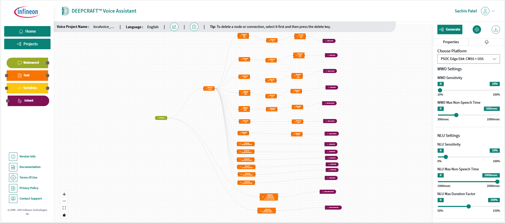

This code example includes the default voice assistant project file which user can directly import into the cloud tool, which is available at *proj_cm55\source\battery_powered_application_hp\inferencing_interface\COMPONENT_VOICE_ASSISTANT\va_proj*

For training a new cloud project,

1. After logging in, select **Design New Project** for creating a new project, then enter the project name and select the language

   or,

   to open an existing project, select **Import Project**, then enter the project name and choose the *.vaproj* file

    **Figure 8. Design or import project**

    

2. For adding a wakeword, like "Ok Infineon", drag the Wakeword element into the canvas as shown:

    **Figure 9. Adding wakeword**

    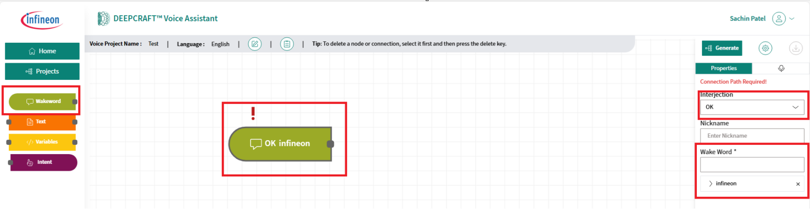

3. To add the commands, drag the **Text** element into the canvas. To add numbers, drag the **Variables** element into the canvas. Ensure to add the required details in the **Properties** tab on the right.

    > **Note:** In the image below, there are **Optional** and **Required** words in the command flow. It shows "can you start the recording" where "can you" and "the" are optional words:

    **Figure 10. Voice assistant commands**

    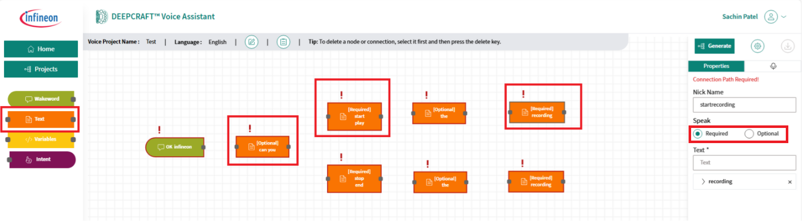

4. Each command flow should be mapped to an intent. Drag the **Intent** element into the canvas and add the intent label. Ensure to connect all the nodes

    **Figure 11. Mapping command flow to intent**

    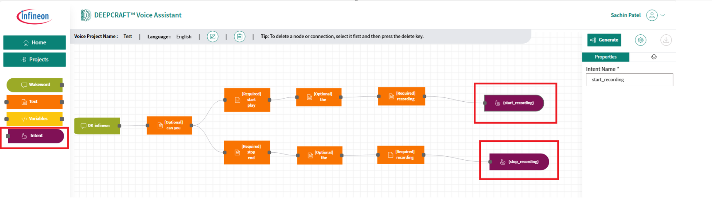

5. After adding all the commands and intent flows, choose the **CM55+U55** option (only this option is supported) and click **Generate**

    **Figure 12. Choosing CM55+U55**

    

    **Figure 13. Generating the model**

    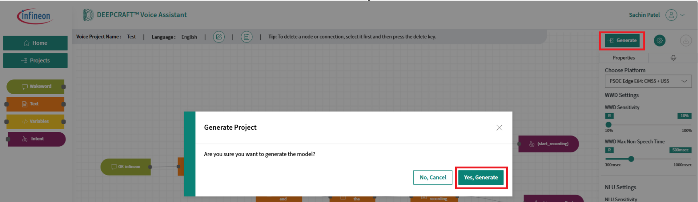

6. Once the model is generated, download the files

    **Figure 14. Downloading files**

    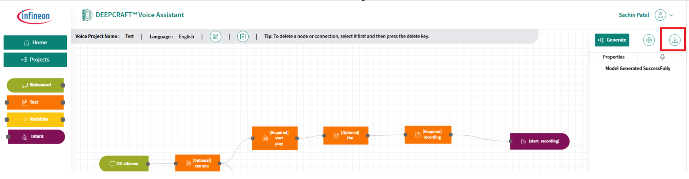

7. Extract the downloaded file and copy and paste all files to *proj_cm55\source\battery_powered_application_hp\inferencing_interface\COMPONENT_VOICE_ASSISTANT\va_model*

8. In *proj_cm55*/*Makefile*, set the name `DEEPCRAFT_PROJECT_NAME=[name of the VA project]`, which is the VA cloud project name prefixed to the downloaded files

9. Update the intent macros and command IDs for the new model in *proj_cm55\source\battery_powered_application_hp\inferencing_interface\inferencing_interface.h*, for example:

    **Figure 15. Adding command IDs and intent macros**

    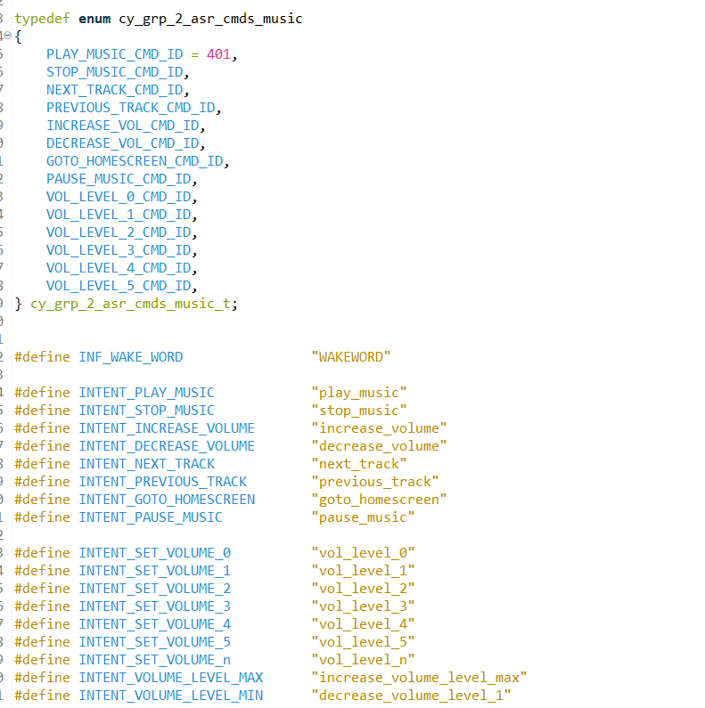

10. Update the `va_intent_to_id()` API in *proj_cm55\source\battery_powered_application_hp\inferencing_interface\COMPONENT_VOICE_ASSISTANT\va_inferencing.c*, which sends the command ID to *battery_powered_post_processing* API defined in *proj_cm55\source\battery_powered_application_hp\inferencing_interface\battery_powered_inferencing.c* file for the post processing

11. Update the `battery_powered_post_processing()` API in *proj_cm55\source\battery_powered_application_hp\inferencing_interface\battery_powered_inferencing.c* which sets the Staged Voice Control (SVC) state and prints the detected command

    **Figure 16. Update battery_powered_post_processing API**

    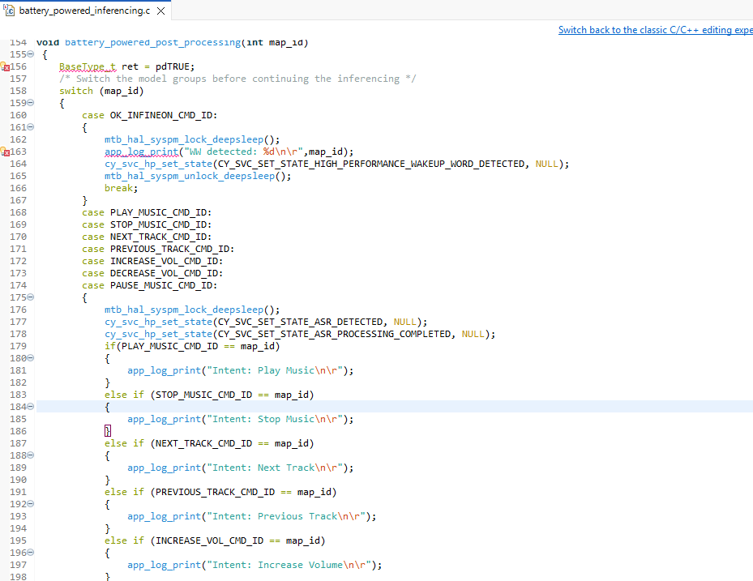

12. To list the supported commands, update the **battery_powered_application_lp.c** file located at *proj_cm33_ns\source\battery_powered_application_lp* and the **audio_feed_to_svc.c** file located at *proj_cm33_ns\source\battery_powered_application_lp* written in **CY_SVC_EVENT_HIGH_PERFORMANCE_WAKEUP_WORD_NOT_DETECTED, CY_SVC_EVENT_ASR_NOT_DETECTED and CY_SVC_EVENT_ASR_PROCESSING_COMPLETED events** so that the supported commands are displayed in the UART terminal

    **Figure 17. Update prints CM33 side**

    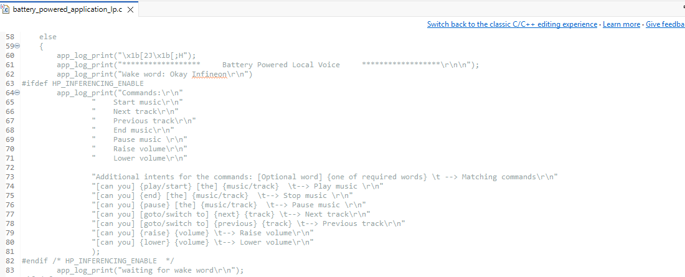

    **Figure 18. Update audio_feed_to_svc file**

    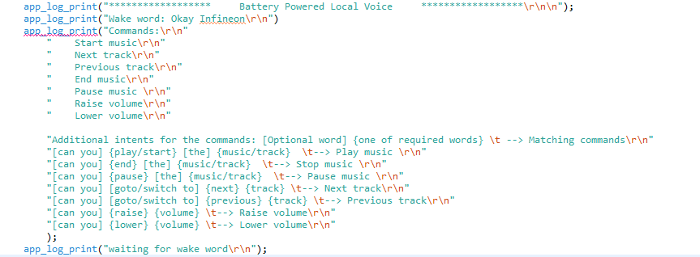


**Custom Low Power Wake Word**

This staged voice control middleware supports the following wake words: "Ok, Infineon", "Hey, Google", "Alexa" and "Xiaodu, Xiaodu". Apart from these wake words, the CE supports the users to use their own wake words as well. To add custom wake word in CE, follow the below steps:

1. Generate the *.tflite file for the required custom wake word. The scripts to generate the *.tflite will be released soon. 

2. Run the DEEPCRAFT&trade; Model Convertor tool. This project creates a *.byom project. Configure the project settings, as shown in the figure

    **Figure 19. DEEPCRAFT&trade; Model Convertor project settings**

    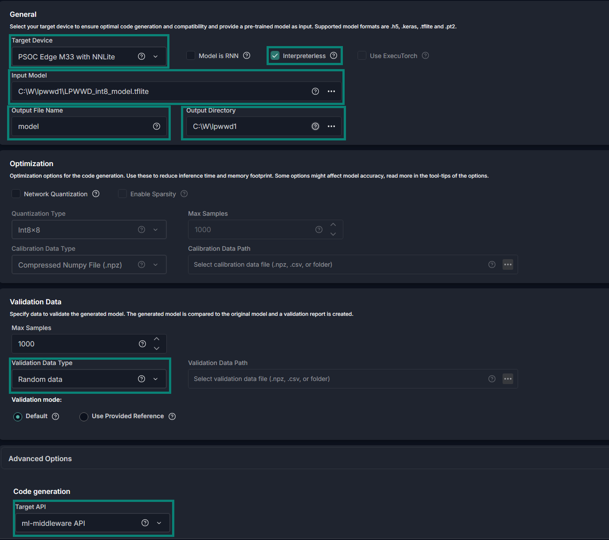

> **Notes:**
> - The Interpreterless mode is selected as it consumes less memory
> - For Low power wake word detection, only interpreterless mode is supported

3. Click on "Start" to generate the .cpp/.h files

4. The files are generated within the mtb_ml_models folder in the output folder specified in the project settings

5. Copy these files to proj_cm33_ns\source\COMPONENT_CUSTOM_LPWWD\COMPONENT_ML_T_LESS_NNL2 folder

> **Notes:**
> - If Interpreter mode is not selected, place the generated .c/.h files in proj_cm33_ns\source\COMPONENT_CUSTOM_LPWWD\COMPONENT_ML_TFLM folder
> - For Low Power Wake Word detection, only interpreterless mode is supported

6. A set of preconfigured parameters are available in COMPONENT_AMIC and COMPONENT_DMIC folders in the COMPONENT_CUSTOM_LPWWD. These parameters need to be tuned for the accurate detections. Refer to the *Low power Wake Word Tuning Guide* Section

7. Comment all the other wake word model components and uncomment the below line in the **Makefile** of proj_cm33_ns 

```
COMPONENTS += CUSTOM_LPWWD
```
8. In the **Makefile** of proj_cm33_ns, set `NN_MODEL_NAME` by replacing `MY_LPWWD` with the model name used in the DEEPCRAFT&trade; Model Convertor tool

```
ifeq ($(filter CUSTOM_LPWWD,$(COMPONENTS)),CUSTOM_LPWWD)
    NN_MODEL_NAME=MY_LPWWD
endif
```

9. In **common.mk**, configure inferencing mode to LPWWD mode only

```
CONFIG_INFERENCING_MODE=LPWWD_ONLY
```
10. Now, build the project and flash the kit

**Low Power Wake Word tuning guide**

A set of preconfigured parameters are available in COMPONENT_AMIC and COMPONENT_DMIC folders in the COMPONENT_CUSTOM_LPWWD. These parameters need to be tuned for the accurate detections. See **Table 3**

**Table 3. Low Power Wake Word tuning parameters**

| Parameter | Description | Recommended range | Default amic value (Ok Infineon) | Default amic value (Xiao-du Xiao-du) |
| --- | --- | --- | --- | --- |
| ww_series | Number of times the keyword is repeated in the wake word. It is 1 if there is no repetition. For a repeated wake word such as "Xiaodu Xiaodu", it is 2. Valid range: 1–2. | 1 - 2 | 1 | 2 |
| ww_tokens | Total number of tokens in the wake word (not including repetition). E.g. Xiao-du Xiao-du -> actual is 4 tokens, but since repetition is ignored, set 2; Ok Infineon -> 2 tokens. | 1 - 2 | 2 | 2 |
| garbage_relative_prob_threshold | The margin by which the garbage class probability must exceed the remaining class probabilities to declare the inference output as garbage. Stored as a 16-bit integer computed as `garbage_relative_prob_threshold = (uint16)(threshold_float * 32768)`. | 0–3277 (≈0.0–0.1, value = float × 32768); near 32768 disables garbage rejection | 328 | 3277 |
| garbage_count_combined_threshold – 1st threshold (low 16 bits, before 1st token) | Low 16 bits: threshold used before the first token probability reaches its probability threshold. | ~12–24 | 23 | 12 |
| garbage_count_combined_threshold – 2nd threshold (high 16 bits, after 1st token) | High 16 bits: threshold used after the first token probability reaches its probability threshold. | ~4–15 | 8 | 9 |
| timeout_combined_threshold – total timeout (low 16 bits) | Low 16 bits: total timeout threshold — the maximum number of post-process iterations before a final detect/reject decision. With a typical 20 ms inference step, the maximum decision time is threshold × 20 ms. Determine this from the maximum wake-word duration in training/test data. | Based on wake-word max duration (~95th percentile); e.g. ~50–150 inferences | 100 | 120 |
| timeout_combined_threshold – 1st-token timeout (high 16 bits) | High 16 bits: pre-first-token timeout threshold — early timeout if the first token never appears. If this value is 0, the algorithm uses a fixed default threshold of 45. | ~½ of total timeout; 0 uses default 45; near/above total time disables early timeout | 45 | 45 |
| prob_threshold[MAX_WW_TOKENS] | Per-token minimum probability for a frame to count as a pass for that token. Probabilities (threshold_float) are floats in [0, 1], but thresholds are stored as 16-bit integers: `prob_threshold = (uint16)(threshold_float * 32768)`. | 13107–22938 (0.4–0.7, value = float × 32768); 16384 (0.5) is a common default starting choice | prob0: 22937<br>prob1: 25231<br>prob2: 0<br>prob3: 0 | prob0: 16383<br>prob1: 16383<br>prob2: 14745<br>prob3: 16383 |
| pass_count_threshold[MAX_WW_TOKENS] | Per-token minimum number of frames where the token probability exceeds prob_threshold required to declare that token fully detected. When all tokens are fully detected, the wake word is detected. Type is unsigned 8-bit; valid range: 1–255. | 1–20; use small values (1–2) for short tokens, tune with fast-speaker data | count0: 6<br>count1: 18<br>count2: 0<br>count3: 0 | count0: 3<br>count1: 2<br>count2: 1<br>count3: 7 |
| gap_threshold[MAX_WW_TOKENS] | Per-token maximum allowed consecutive gap frames where the token probability is below its threshold, measured from when the token first reaches its threshold until the next token first reaches its threshold (or until the token is detected if it is the last token). Type is unsigned 8-bit; valid range: 0–255. | 5–40; larger for a token that follows a pause (e.g. 2nd repeated token) | gap0: 25<br>gap1: 21<br>gap2: 0<br>gap3: 0 | gap0: 20<br>gap1: 35<br>gap2: 25<br>gap3: 20 |

The MAX_WW_TOKENS is internally set to 4.


With reference to **Table 3**, this section briefly describes how to tune the parameters.

Internally the Low Power Wake Word (LPWW) algorithm has the following variables. These are not available for users. They use the parameters from the Table 3 to internally manage the algorithm.

- tok_count[MAX_WW_TOKENS]
- gap_count
- garbage_count
- noise_count
- before_1st_tok_count
- timeout_count

tok_count[MAX_WW_TOKENS] - This internal counter increments each time a token probability exceeds its *prob_threshold[token]*. When this counter reaches *pass_count_threshold[token]*, then it is considered as token detected. The internal state moves to the next token after the current token drops below its threshold. 

gap_count - This internal counter measures consecutive frames where the token probability is below the *prob_threshold[token]*. It is a down counter initialized to *gap_threshold[token]*. And once it is crossed then algorithm considers that wake word is not detected.

garbage_count - This is an internal counter that increments once garbage class probability exceeds other class probabilities by *garbage_relative_prob_threshold*.

There are two garbage count thresholds which are used by the algorithm (see **Table 3**):

- *garbage_count_combined_threshold – 1st threshold (low 16 bits, before 1st token)* - Applies before first token is seen. If garbage_count exceeds this, then wake word is rejected

- *garbage_count_combined_threshold – 2nd threshold (high 16 bits, after 1st token)* - This applies after the first token is seen. If this is exceeded then wake word is rejected

noise_count - Internal counter that increments when noise class is highest among other classes.

before_1st_tok_count - Internal counter that counts number of inferences before first token is detected. If the first token does not appear before this counter reaches *timeout_combined_threshold – 1st-token timeout (high 16 bits)*, wake word is rejected.

timeout_count - Internal count that tracks the total number of inferences, if no detection or rejection happens before this counter reaches *timeout_combined_threshold – total timeout (low 16 bits)* the algorithm forces a final decision.


**Tuning tips**

For tuning, the following parameters from **Table 3** can be adjusted depending on the use-case so that the internal counters can process the thresholds for wake word detection.

- timeout_combined_threshold – total timeout (low 16 bits) - Set to wake word maximum duration length at around 95 percentile. See **Table 3**

- timeout_combined_threshold – 1st-token timeout (high 16 bits) - Set this around half the value of *timeout_combined_threshold – total timeout (low 16 bits)*. If set to zero and it uses a default value of 45 and skips this tuning parameter. If set to the value close to the *timeout_combined_threshold – total timeout (low 16 bits)* early timeout is disabled

- prob_threshold[MAX_WW_TOKENS] - Set above 13107 (0.4) to minimize false detection

- pass_count_threshold[MAX_WW_TOKENS] - Set to higher value to reduce false detection

- gap_threshold[MAX_WW_TOKENS] - Set to at-least the amount of speech pause/gap between next token. Smaller values reduce false detection and reduces detection rate

- garbage_relative_prob_threshold - Set to higher value to disable garbage based rejection. When set to low/zero, garbage_count increases when garbage class has the highest probability. As a starting point, set garbage_count_threshold first to ~12 and second to ~10. Lower values reduce false alarm, detection rate especially when wake word is mixed with noise/garbage

Tuning these parameters require balancing between true detection and false alarm rate. It is suggested to first adjust *prob_threshold[MAX_WW_TOKENS]* and *pass_count_threshold[MAX_WW_TOKENS]* as they have significant impact than adjusting *gap_threshold[MAX_WW_TOKENS]*.

Adjusting garbage thresholds have more significance in noisy versus quiet conditions.

It is suggested to tune first in quiet environment and then tune in various noise environment. A trade-off is needed between detection rate and false alarm rate. The general guideline for false alarm rate is under 3 false alarm per hour.

For fast vs. slow talkers, if tuning is done for fast talkers, the parameters would generally work for slow talkers also. Recommendation is to adjust *prob_threshold[MAX_WW_TOKENS]* to be 16384(0.5) and above. For fast talkers, *pass_count_threshold[MAX_WW_TOKENS]* should also be adjusted to a lower value (for example, 1-2).

For medium to slow talkers, adjust the *gap_threshold[MAX_WW_TOKENS]* to accommodate larger gaps between tokens.

**Power KPI**

See the [Preliminary KPI: Power profile](power_profile.md).

To profile the AFE middleware for the cycles:

1. Enable the following in the *Makefile* of *proj_cm55*:

    ```
    #For Profiler
    COMPONENTS += PROFILER
    DEFINES += PROFILER_ENABLE
    ```

2. Enable the following flag in
*proj_cm55\source\battery_powered_application_hp\audio_enhancement\battery_powered_ae_interface.h*:

    ```
    #define AE_APP_PROFILE  (1)
    ```
3. Disable the PD1_POWER_CYCLE by commenting the below line in *common.mk*

    ```
    DEFINES+=PD1_POWER_CYCLE
    ```

To profile Voice Assistant for the cycles:

1. Enable the following in the *Makefile* of *proj_cm55*:

    ```
    #For Profiler
    COMPONENTS += PROFILER
    DEFINES += PROFILER_ENABLE
    ```

2. Enable the following flag in
*proj_cm55\source\battery_powered_application_hp\audio_enhancement\battery_powered_ae_interface.h*:

    ```
    #define INFERENCING_PROFILE  (1)
    ```

It is recommended to use CM55 streaming mode for profiling AE and VA.

**Audio Benchmarking of battery powered local voice pipeline:**

The battery powered local voice pipeline benchmarking with Analog Mic input is as follows,

Setup details:

1.	With Analog mic input to the audio pipeline, talker speaker is set at 1 foot from the analog mics on the kit

2.	Noise speaker is set at 3 feet from the kit at an angle of 45 degrees, not facing the analog mics on the kit

3.	SNR is controlled by adjusting the output levels on both speakers. The SNR values are as shown below

    **Figure 20. SNR details**

    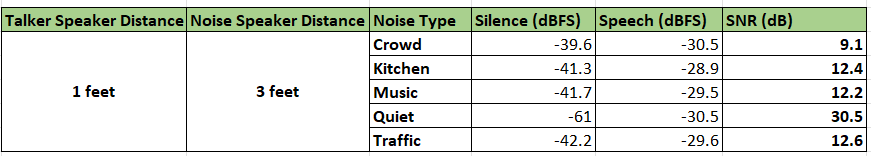

4. The benchmarking statistics for both native and non-native accents are as given below

    **Figure 21. Full pipeline performance benchmarking**

    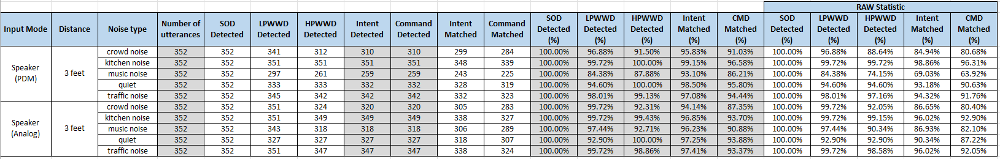

In **Table 3**, there are 2 sets of results.

It shows the raw statistics. Raw statistics = detections/total number of utterances

It also shows the results based on the previous stage in the audio pipeline. For example, HPWWD % will be the number of HPWW detected/number of LPWW detected and not based on number of utterances. This gives the individual stage detection statistics

> **Note:** The benchmarking results could vary depending on environment. The statistics will also be improved in future versions of this code example.
