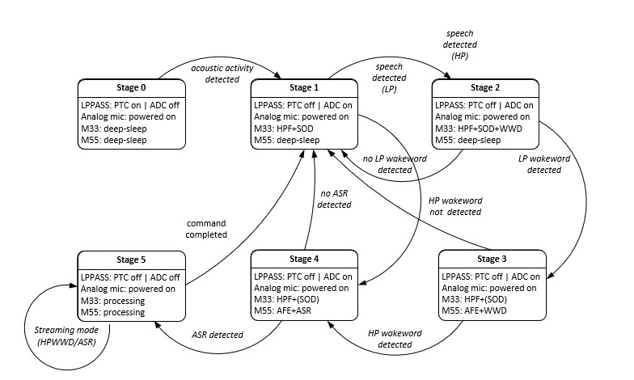
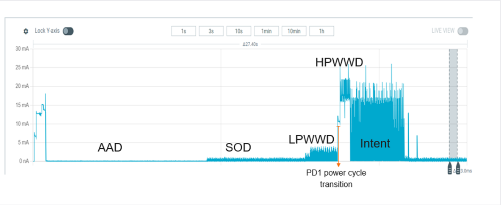

[Click here](../README.md) to view the README.

## Preliminary KPI: Power profile

The PSOC&trade; Edge MCU's power consumption is estimated by measuring the currents of the VBAT = 3.3 V and VDDD + VDDIO = 1.8 V domain. The VBAT and VDDD + VDDIO domain currents can be measured using the J25 and J26 jumpers respectively on the PSOC&trade; Edge MCU Evaluation Kit.

## Staged Voice Control (SVC)

Staged voice control middleware provides easy to use API on Arm&reg; Cortex&reg;-M33 core to feed the audio data, get notified about current stage in the audio pipeline. On Arm&reg; Cortex&reg;-M55 core, it provides simple to use API to get the data from Arm&reg; Cortex&reg;-M33 core and sending the notification about stage change to Arm&reg; Cortex&reg;-M33 core.Refer to the **Figure 1** for understanding the different Staged Voice Control (SVC) stages which are being used in the code example.

**Figure 1. Staged Voice Control (SVC) state machine**

## Description of each stage

### Acoustic Activity Detection (AAD)

Acoustic Activity Detection (AAD) is the lowest power stage of the system. It uses ultra-low-power analog path to sense whether any meaningful sound is present near the device. At this stage, the system is not trying to recognize speech or words, it simply determines whether the environment is quiet or if something that “might be speech” is happening.

### Speech Onset Detection (SOD)

Once the system detects general sound activity, Speech Onset Detection (SOD) determines whether the sound actually resembles human speech. It distinguishes speech from background noise (e.g., footsteps, rustling, music) and triggers the next stage only when speech-like patterns displays. This ensures the device wakes LPWW stage only when someone actually begins talking.

### Low Power Wake Word Detection (LPWWD)

In this stage, simplified model continuously listening for the wake word (e.g., “Okay Infineon") running on NNLite NPU. Low Power Wake Word Detection confirms whether the speech detected could potentially be the wake word. If it finds something close to the wake word, it streams the audio stream to inferencing library on CM55 for High Performance wake word detection (HPWWD). In this code example DEEPCRAFT&trade; Voice Assistant (VA) is used as inferencing library.

### High Performance Wake Word Detection (HPWWD)

After Low Power Wake Word Detection infers a possible wake word, the High Performance Wake Word Detection library performs a more accurate prediction. This stage confirms with high confidence whether the actual wake word was detected. It minimizes false activations while ensuring the system responds quickly when actual wake word is detected.

### Natural Conversation / ASR Command

Once the wake word is confirmed, the system activates full-speech recognition to understand the user's spoken command. At this stage, the DEEPCRAFT&trade; Voice Assistant (VA) captures the full utterance (e.g., “raise volume”, “play music”) and infers the commands.

## Power measurement

See **Table 1** for the power numbers of each stage with DEEPCRAFT&trade; Audio Enhancement (AE). Audio components High Pass Filter (HPF), Dereverberation (DRVB) and Noise Suppression of DEEPCRAFT&trade; Audio Enhancement (AE) are enabled.

**Table 1. CPU currents for battery powered local voice configuration, VBAT = 3.3 V (J25), VDDD = 1.8 V (J26)**

Configuration | IBAT (uA) | VDDD + VDDIO (uA) | Total power (mW) | Description
:-------- |:-------- | :----------  | :---------- | :--------
Low Noise (AAD) | 49.15 | 35.92 | 0.227 | In quite scenario, the device will be in Acoustic Activity Detection (AAD) stage
High Noise (SOD) | 88.13 | 56.88 | 0.393 | Seven seconds, if speech is not detected in seven seconds fallback to Acoustic Activity Detection (AAD) stage
Wake Word (LPWWD) | 310 | 94.82 | 1.194 | Four seconds, if WWD is not detected in four seconds fallback to Speech Onset Detection (SOD) stage
Natural Conversation (command/intent) | 5400 | 380 | 18.504 | Six-seconds frame count based on timeout of DEEPCRAFT&trade; Voice Assistant (VA)   if command/intent is not detected fallback to Speech Onset Detection (SOD) stage

 

See **Figure 1** for the high-level power information for each stage.

**Figure 1. Power for each stage**

